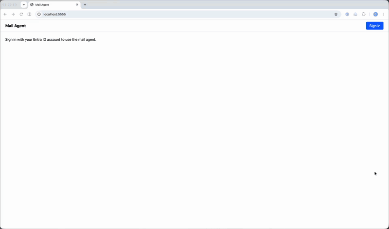

# watsonx Orchestrate Mailbox Agent Via Entra ID OBO

## Demo



[Full quality video (demo.mp4)](demo.mp4)

Read-only mail agent: user signs in to a host page with Entra ID, the page embeds watsonx Orchestrate (wxO) web chat, wxO exchanges the user's token for a Microsoft Graph token on behalf of the user and calls Graph through an OpenAPI tool.

> **Note:** This sample is not guidance on configuring Microsoft Entra ID or Microsoft Graph. It is only an example of how to set up OBO (on-behalf-of) token exchange in watsonx Orchestrate. Follow Microsoft's documentation and your organisation's policies for Entra ID and Graph.

```
User ── sign in ──> Entra ID ──(token, aud = your API)──> Host server
Host server ── signed JWT, user_payload.sso_token = Entra token ──> wxO embedded chat
wxO ── OBO: assertion = sso_token ──> Entra ID ──(Graph token)──> wxO
wxO OpenAPI tool ── Bearer Graph token ──> graph.microsoft.com/v1.0/me/messages
```

The `token_exchange` connection with Entra OBO body fields has been verified end to end in embedded chat.

## Prerequisites

1. Entra ID tenant and a user with an Exchange Online mailbox licence. Without it `/me` works and `/me/messages` returns 404 or `MailboxNotEnabledForRESTAPI`.
2. wxO SaaS instance.
3. Python 3.11 to 3.14 (required by the ADK).
4. ADK installed in a Python virtual environment, with the SaaS environment added and activated:

   ```bash
   python3 -m venv .venv
   source .venv/bin/activate
   pip install -r requirements.txt
   orchestrate env add -n <name> -u <service-instance-url> --activate
   ```

   See [Configure access to remote environments](https://developer.watson-orchestrate.ibm.com/environment/initiate_environment). Authentication against a remote environment expires about every two hours, so re-run `orchestrate env activate <name>` when commands start failing with auth errors.
5. Node 20 or later and npm (host page).
6. `openssl` (Step 3 keys).

## Steps 1 And 2: Entra ID Requirements And OBO Check

The app registration requirements (Step 1) and the standalone OBO check with `verify-obo.sh` (Step 2) are described in [entra-obo.md](entra-obo.md).

## Step 3: Secure Embed Keys

```bash
mkdir -p host/keys && cd host/keys
openssl genrsa -out jwtRS256.key 4096
openssl rsa -in jwtRS256.key -pubout -out jwtRS256.key.pub
```

Then, in the watsonx Orchestrate UI (see IBM's [Configuring security for embedded chat](https://www.ibm.com/docs/SSAVQO/deploy/web_chat_agent/web_chat_configuring_security.html)):

1. Open the watsonx Orchestrate SaaS UI.
2. Click the profile icon in the top right corner and open **Settings**.
3. Open **Embedded chat security** (Embed security), then the **Security** section.
4. In **Public key**, paste the contents of `jwtRS256.key.pub` and save.
5. Copy the **IBM provided public key** and save it as `host/keys/ibmPublic.key.pub`.

## Step 4: wxO Connection, Tool And Agent

Run:

```bash
export TENANT_ID=... CLIENT_ID=... CLIENT_SECRET=...
bash setup.sh
```

The script imports the connection, sets credentials for draft and live, imports the OpenAPI tool bound to the connection, imports the agent and deploys it.

Then, in the watsonx Orchestrate UI, open the agent `mail_reader` -> **Deploy** tab -> **Channels** -> **Embedded agent**. Copy `orchestrationID`, `hostURL`, `agentId` and `agentEnvironmentId` from the embed script (and `deploymentPlatform` and `crn` if they are present) for `host/.env`.

## Step 5: Run The Host Page

```bash
cd host
cp .env.example .env   # fill in values from Steps 1 and 4
npm install
npm start
```

Open `http://localhost:5555`, sign in as a licensed user, then ask the agent:

- "What are my five most recent emails?"
- "Any unread mail from today?"
- "Open the latest one and summarise it."

SSO works only in embedded chat. The wxO preview chat will not have an SSO token.

## Troubleshooting

| Symptom | Likely cause | Fix |
| - | - | - |
| `AADSTS50013` or invalid audience on OBO | Host passed an ID token or a Graph token | `sso_token` must be the access token for `api://<client-id>/access_as_user` |
| `AADSTS65001` | Consent missing | Grant admin consent for `Mail.Read` and `User.Read` |
| `AADSTS50076` or `AADSTS50079` | Conditional Access or MFA claims challenge | Review Conditional Access policies for the user, or re-authenticate in the host page |
| Tool returns 401 from Graph | wxO did not run the OBO exchange as expected | Check the connection credentials for draft and live (`bash setup.sh`) and run `verify-obo.sh` |
| Chat does not load | Keys not configured, or JWT expired | Re-run Step 3; check server log |
| wxO rejects the JWT | `user_payload` too large for IBM's key after encryption | The Entra token is about 1.5 to 2.5 KB. IBM's sample does the same, but if decryption fails, raise it with IBM |
| `/me` works, `/me/messages` fails | User has no mailbox licence | Assign an Exchange Online licence |
| `/me/messages` returns an empty list | The mailbox has no messages yet | Send a test email to the user |

## Security Notes

- Email content is untrusted input. The agent instructions tell it to ignore instructions inside emails, but treat that as a mitigation, not a control. Keep the tool set read-only unless you add human confirmation and wxO guardrail controls.
- `Mail.Read` grants every mail folder. For narrower scope, consider Exchange application access policies or RBAC for Applications.
- Host server holds Entra tokens in memory per session. Prod needs a distributed token cache, HTTPS, `secure` cookies and a real session store.
- wxO JWT lifetime is capped to the Entra token's remaining life so the chat never carries a dead SSO token.
